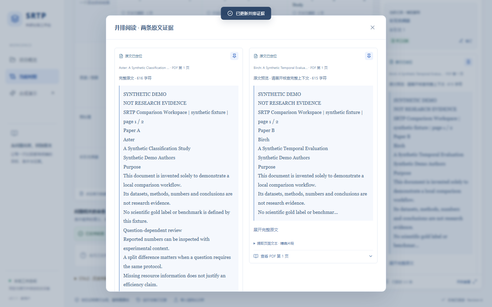

# 团队预览验收与发布计划

日期：2026-10-10。结论：**TEAM_PREVIEW_LOCAL_ACCEPTED / AWAITING_PUSH_AUTHORIZATION**。
真实模型调用 0；未 push、merge、改 PR #87，未创建真实 Analysis，未改历史 Run 或冻结研究材料。

## 版本与范围

- 持续使用 `codex/comparison-workspace-identity-robustness`；起始 HEAD `0f89e28463501633053b3bef33243c8e7f01f272`，起始工作区干净。
- 本轮代码提交 `27d416c7f696a650332ddddea95013da96e7469a`；后续提交仅含本报告、演示说明与合成截图。
  **最终候选是包含本报告的提交**，交付时以 `git rev-parse HEAD` 的完整 SHA 冻结，不用可漂移的分支名代替 SHA。
- GitHub main 实查为 `5876190f9c2f959d37a2755274298a7138f9af51`，是本地候选祖先。
  PR [#87](https://github.com/ZicanLiu/ai-literature-intelligence/pull/87) 仍 OPEN，head `fc7de566420829e3b53ac511b0ae9e82a566bba3`，
  分支 `codex/comparison-workspace-v01`；该 head 同样是候选祖先。当前候选保留全部原 v0.1.1 未推送提交。
- 最终候选相对 main 共 24 个提交，包含本轮之前的 22 个和本轮 2 个；不是只发布前端小补丁。
  主仓原工作树、其他 worktree、main 和既有任务分支均未切换或重置。

## 实际修改

| 文件 | 改动与目的 |
| --- | --- |
| web/comparison-workspace/src/EvidenceQuote.tsx | 超过 600 Unicode 字符显示前 360 字符预览；明确“请展开核查完整上下文”；展开/收起具有 aria-expanded/controls；全文直接使用 canonical 字符串 |
| web/comparison-workspace/src/App.tsx | 共用折叠组件；更换证据时重置卡片阅读状态；修复已复现的 popstate 再次 pushState 导致前进记录丢失 |
| web/comparison-workspace/src/styles.css | 保留原样断行，增加预览说明和按钮样式，沿用原响应式布局 |
| web/comparison-workspace/tests/workspace.spec.ts | 增加前进/后退、长引文、短句不折叠、独立并排展开、精确全文/高亮、PDF、窄屏及读操作不改项目的真实浏览器回归 |
| web/comparison-workspace/playwright.config.ts | 测试数据目录可显式隔离；普通端点硬离线、另一个只接 SDK mock |
| scripts/start_comparison_workspace.py、start-team-preview.cmd | Windows 一键安装/启动；独立虚拟环境；始终硬离线并剔除进程 Key；更新安装使用 npm ci，重复启动复用依赖与构建 |
| .gitignore | 忽略新增虚拟环境；无私人配置进入跟踪 |
| README、PRODUCT_GUIDE、LIMITATIONS、DEMO_SCRIPT、TEAM_PREVIEW、THIRD_PARTY_NOTICES | 团队安装、演示、反馈、数据位置、许可与真实科学验证状态 |

没有修改 backend 业务、provider、validator、locator、span producer、依赖版本或锁文件。
折叠只影响呈现：quote/hash/offset/ownership、提取页文本、PDF 页入口、状态与导出完整内容不变。
同一个证据卡用于检查器和并排阅读；短句直接显示，不强制展开。

## 验证结果

在干净代码提交 27d416c 上按 CONTRIBUTING 唯一顺序执行完整 unittest **一次**，再执行两个 Gate --skip-tests：

| 检查 | 实际结果 |
| --- | --- |
| 定向 comparison workspace 离线回归 | 116 tests，PASS，0 skip，15.324 秒；显式配置真实 S1-A、旧 S1-B、span live 保存产物的离线回放 |
| 完整 unittest | 1197 tests，OK，15 条件性 skips，281.492 秒；无失败，外层命令约 287 秒 |
| Basic Gate --skip-tests | PASSED，605 files，0 error / 0 warning |
| Full Gate --skip-tests | PASSED，605 files，0 error / 3 历史 warning |
| TypeScript / Vite production build | PASS；与干净安装输出一致；PDF worker 本地打包，未用 CDN |
| 开发环境 Chromium 浏览器 | 21/21 PASS，39.7 秒 |
| 干净检出、新 Python 依赖环境 Chromium 浏览器 | 21/21 PASS，39.7 秒；重复执行是为了检验新装依赖差异 |
| 新虚拟环境 pip check / npm ci audit | 无依赖冲突；npm 77 packages / 0 reported vulnerabilities；不是全面安全保证 |
| 全部任务 diff / whitespace | PASS；最终报告提交后再次检查 |
| 历史保护 | 191 文件前后哈希一致；其中原先声明的 165 文件另与上一轮 manifest 对比一致 |

三个 Full 警告：历史 W1 CSV 结构、19 个历史 annotation ID 不在当前统一样例、已跟踪的旧
openalex_stellar_spectra_60 experiment。保留原始材料，未降级断言或修改数据。
15 条条件性跳过不是已声明的 workspace 私有 replay；该定向集合 116 项无 skip。
测试输出中的损坏 PDF / FAIL CLOSED 为预期负例，以 unittest 的 OK 和退出码判定。

浏览器覆盖：首页、合成演示、PDF 上传、手工候选与活动目标、矩阵、定位/页面高亮/PDF canvas、
并排证据、Correction 与 STALE、保存后重开、Markdown/JSON/CSV 下载与内容断言、
1440×900 / 1280×800 / 390×844 布局。浏览器 pageerror 与远程页面资源检查通过。
BYO/Live UI 测试只使用固定 SDK mock 和虚构测试 Key，非真实生成或认证请求。
另由 AI 通过实际应用浏览器操作复验前进/后退、长引文精确全文和 PDF 阅读；不属于科研 HUMAN_CONFIRMED。

## 首次与再次启动

从候选代码克隆到新的含空格目录，无 .venv-workspace、node_modules、dist；Python 禁用 pip 缓存、
npm 使用全新空缓存，成功从 registry 安装并构建。未使用旧开发 venv 来证明首次安装。
实测 Python 3.13.9 / Node 22.21.0 / npm 10.9.4；新装 FastAPI 0.143.0、Pydantic 2.14.0、
Uvicorn 0.54.0、pypdf 6.20.0、OpenAI SDK 2.54.0、httpx 0.28.1。
React/ReactDOM 19.3.0、Vite 7.3.6、PDF.js 6.4.299 来自未修改的 npm 锁文件。

创建合成项目后停止该隔离后台；设置 PIP_NO_INDEX=1 / npm offline，再次运行同一 cmd。
未安装/重建即可启动；浏览器刷新后同一个 project 恢复、21 个矩阵单元格存在、无错误。
设置页面显示 Key 未配置、硬离线开启。全部验收使用专用数据目录，未使用组长个人数据库。
这是同一台 Windows 的干净依赖检出，不等同五台机器/所有 Python 版本已验证。

团队启动：根目录运行 `.\start-team-preview.cmd`，打开 http://127.0.0.1:8765。
后续更新：`git pull --ff-only` 后 `.\start-team-preview.cmd --install --rebuild`。
完整步骤、五分钟合成演示、长引用练习和反馈模板均在 [团队指南](../../docs/comparison_workspace/TEAM_PREVIEW.md)。

## 发布审查

扫描 main 之后**每个提交**的改动 blob，包括较早已被后续覆盖的版本，核对文件清单、类型、大小、
常见凭据/私有路径模式；视觉检查六张旧截图和新截图，均为自制 Synthetic Demo。
没有新增真实 PDF、工作台 SQLite、私有 Run、完整模型响应、HTTP/HAR、Key、认证头或本机专有配置。
扫描无真实凭据命中、无大于 1 MiB 的新增 blob；唯一路径命中为构造的 private-test-user 泄漏测试。
workspace.sqlite3 文字命中只涉及源码文件名、测试查找路径和使用指南，不是提交数据库。

**继承材料例外**：main 早已公开跟踪 `outputs/experiments/openalex_stellar_spectra_60/literature.db`
（266240 字节）。本轮和全部工作台提交均未修改它；它会随整仓 clone 继承，不能宣称整仓零数据库。
为保护科研历史不删除它；它不是组长工作台数据库。不要直接压缩开发目录或分享私人数据目录。

第三方 npm/pip 原许可随包安装保留；源码预览不分发 node_modules / dist。PDF.js Apache 与
React/Lucide 等许可义务已记录；若将来单独分发构建产物，须附完整许可与适用 NOTICE。
根仓目前无整体 LICENSE，本轮不擅自授予许可；正式开源/二进制发行仍需所有者决策。

## 冻结边界与下一步

已满足本地团队源码预览验收，未证明科学内容正确、稳定性、研究优越性或外部有效性。
S1-B 保持 `SPAN_V0_LIVE_EXTRACTION_TECHNICAL_PASS / SCIENTIFIC_REVIEW_PENDING`；
长页边界仅离线验证，原 Run 的第 6 页未引用事实不变；Human Gold / S1-B Analysis 均未完成。
未读取 .env，未发送真实 DeepSeek/OpenAI 请求，未发第三论文族测试。

主要局限：单用户单后台、无 OCR、复杂表格/字体提取可能缺失科学上下文；LOCATED 不是科学支持。
Python 依赖仍用版本范围，未来新安装可能解析不同补丁；五名成员的环境与实际使用体验尚待反馈。

预定新远端分支：`preview/comparison-workspace-team-20261010`，本轮 ls-remote 两次未见冲突。
收到用户明确推送批准后，重新检查远端 main / PR / 分支名、候选 SHA 与 clean 状态，
仅以普通非 force push 将**冻结 SHA**推到该新分支；如分支已存在则停止，不更新/覆盖它，另协商名称。
不合并 main，不修改 PR #87，不自动创建或发布 release。推送后的团队公告/Issue 也需另有授权。

本地原始验收日志、依赖清单、保护 manifest 和安全扫描留在仓外 team_preview_readiness_20261010，
不提交数据库/本机路径/完整测试日志。以下截图只含自制合成材料：

[窄屏并排阅读截图](screenshots/long-pair-narrow.png)
