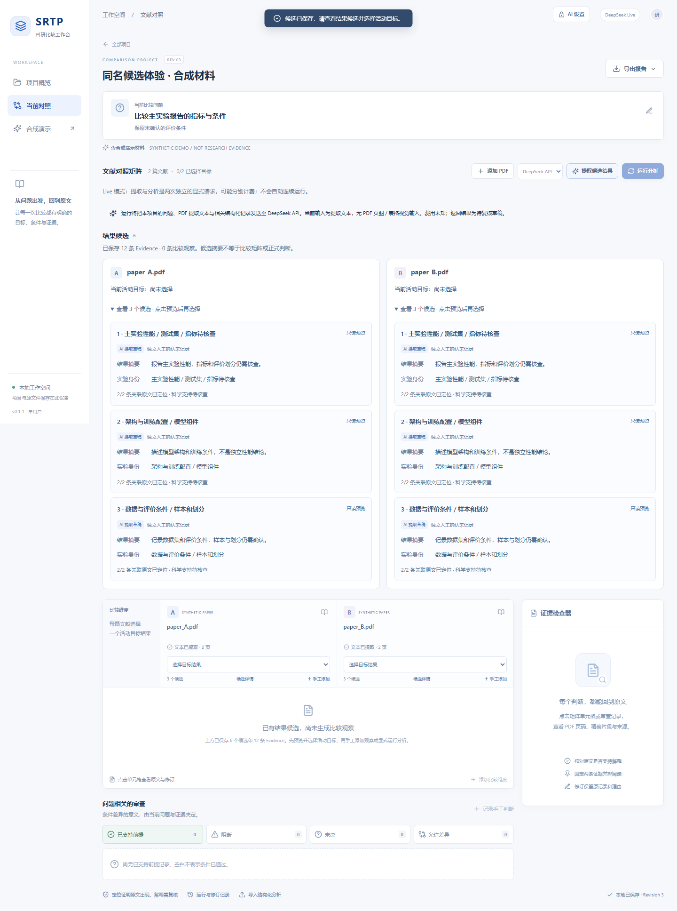
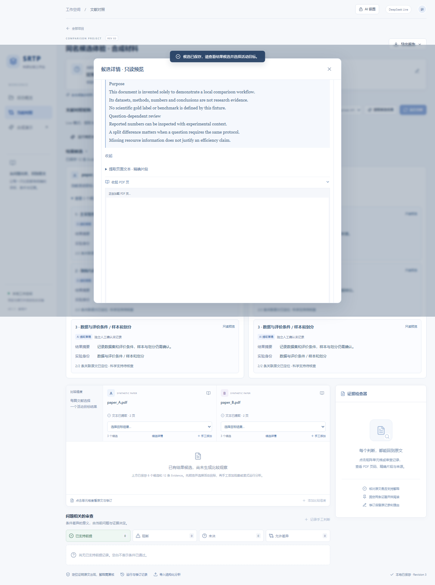
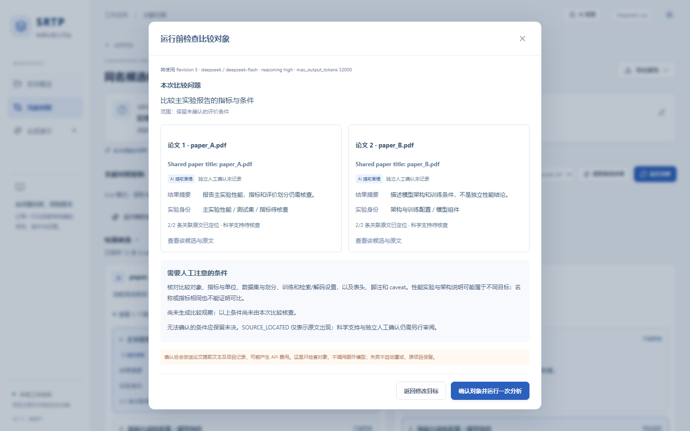
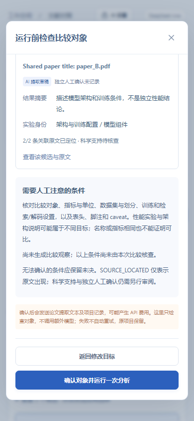

# Team Preview v2 本地验收与待批准发布计划

日期：2026-10-10。状态：**TEAM_PREVIEW_V2_LOCAL_ACCEPTED**。仅表示本轮单机、离线及 mock 体验验收通过；不是新的真实模型实验、科研有效性结论或 GitHub 发布状态。

**Git 基线与最终候选**

- 本轮分支：`codex/comparison-workspace-team-preview-v2`。在原有独立工作树从 clean 的 `7b06658ef0db1efe7fc0544e78a64e26f183a637` 创建，原 identity-robustness 分支与所有未推送提交保留。
- 产品代码与浏览器截图提交：`5fea23e5737739db4309a0a9c694ec7257cf6fe1`。之后仅收口本报告及启动说明；最终候选为包含本报告的文档提交，精确 SHA 由最终交付与 `git rev-parse HEAD` 给出。没有重写历史提交。
- 实际只读远端核对：main=`5876190f9c2f959d37a2755274298a7138f9af51`；旧预览=`3b3b984d217a0c734c47b9a45540646f2dfdebd8`；PR #87 OPEN，head=`fc7de566420829e3b53ac511b0ae9e82a566bba3`，base=上述 main。
- main、旧预览、原本地 `7b06658` 均在候选祖先链中。没有合并、rebase、push、tag、Release、Issue 或 PR 修改。

**真实问题与本轮取舍**

仅在仓外建立用户数据的字节一致隔离副本后诊断和浏览器读取。当前副本实际为 Revision 10：两篇 PDF、6 个候选、15 条 LOCATED Evidence、0 个 Observation / 手工 Finding；同论文三条候选标题重复。论文 identity.title 是文件名，而 Result.title 是论文名称，二者并不相等。历史失败 Analysis 仍是 Revision 7、structured_output_schema / `$`，具体解析原因 UNKNOWN；当前 RAG 活动目标已由用户切到 QA 候选，不能沿用历史误选状态描述现在的项目。

没有改写用户结果、选择或旧 Run。RAG QA 候选仍含不同变体，检索/解码和评价条件需要用户逐主张确认；本轮没有新的科学裁决或 Human Gold。

优先使用既有 title / description / experiment_identity / evidence_ids / provenance。没有新增 Result 类型、数据迁移或分类器，避免把按关键词猜测的类别写为科研事实；也没有硬编码 DPR、RAG 或论文性能数字。

| 用户问题 | 实际界面变化 | 边界 |
| --- | --- | --- |
| 三个同名候选难辨 | 同论文重复标题的菜单改用既有实验身份；候选卡显示摘要、实验身份、来源状态与活动标识 | 原始 title 不改，编号只是展示，不是科研类别 |
| 选择前看不到细节 | 只读详情提供完整摘要、实验身份、来源 provenance、关联原文、长引用折叠与 PDF 页 | 预览/展开不保存选择、不调用模型；“设为活动目标”才保存 |
| Extraction 后像空白 | 独立候选概览显示候选与 Evidence；空矩阵明确“已有候选，尚未生成比较观察” | 不把 Result 摘要变成 Observation，不虚构 Finding |
| 容易把配置与性能当成同类目标 | Live Analysis 前展示问题、scope、每篇活动结果、来源状态、已有未决观察和科学检查提示 | 不凭名字机械判定可比，也不把点击确认当作科研人工认证 |
| 按钮难找、模式不明 | Extraction 与 Analysis 同一工具栏，说明手工/演示/Live、硬离线和分别计费 | 默认离线，提取不自动进入分析，Live 仍须本人 Key 和授权 |
| 重复点击、旧视图回写 | 请求提交期间禁用按钮并同步防重复；复核 revision 与最新可见 AI 配置；导航时关闭旧预览与轮询，迟到刷新不复活已离开的项目 | 后台既有 expected_revision / 发送前授权仍是边界，不改变来源校验 |
| 失败后的困惑 | 沿用前轮安全解析分类、UNKNOWN、已消耗 token 与原项目保留提示，运行记录可追溯 | 没有宣称已经修复 DeepSeek 的真实成功率 |

界面明确区分 AI 提取草稿、手工记录、用户修订，以及“独立人工确认未记录”。当前数据模型没有独立人工认证字段，本轮不伪造该状态。SOURCE_LOCATED 与科学支持仍分开。

**代码范围与输入冗余**

产品改动仅前端：App.tsx、styles.css、新的 ResultCandidates.tsx 与 AnalysisReview.tsx；复用原 EvidenceCard / EvidenceQuote / PDF.js。没有新增依赖、数据库表、后端端点、账号或云服务。更新两个 Playwright 文件及 SDK mock 场景；团队指南、产品指南、演示脚本和独立反馈模板同步。

Provider、Analysis Schema、默认 reasoning/预算、handle/span producer/resolver、identity/source/active-result/exact-quote validator、Correction/STALE 与导出合同均未改。SDK/HTTP 重试策略未改，没有宽松 JSON 修复、删除坏引用或部分接收。

前轮保存元数据显示，失败 Analysis 输入 54,948 tokens，成功 S1-A 为 40,285；当前输入同时包含约 124,936 字符页面原文和 32,664 字符既有 Evidence quote，还有全部候选及活动结果。已定位 quote 与页面内容存在重复，但不同协议、解析器与候选数量混杂，不能把 token 增量全归于某一字段。字符数也不是精确 token 或费用。本轮不删源页、证据、修订或 caveat，不改变模型输入，留待独立离线方案评估。

**验收结果**

完整 unittest 在 clean 产品提交 `5fea23e` 上运行一次，再依 CONTRIBUTING 执行 Basic / Full `--skip-tests`，没有重复完整套件：

| 检查 | 实际结果 |
| --- | --- |
| 定向 comparison workspace unittest | 123 tests，OK，0 skip，31.784 秒 |
| 完整离线 unittest | 1204 tests，OK，15 条件性 skips，402.790 秒，无失败 |
| Basic Gate --skip-tests | PASSED，618 files，0 error / 0 warning |
| Full Gate --skip-tests | PASSED，618 files，0 error / 3 既有 warning |
| TypeScript + Vite build | PASS；没有新增依赖或锁文件变化 |
| Chromium 浏览器完整回归 | 29/29 PASS，1.3 分钟；硬离线 + SDK mock，隔离目录 |
| 真实用户隔离副本浏览器只读检查 | PASS；6 候选/15 Evidence、实际同名菜单、完整 canonical quote、PDF、历史 UNKNOWN；0 写请求、0 外部请求、0 浏览器异常 |
| 干净检出首次安装 | PASS；新 venv、无 node_modules/dist，禁用 pip cache、全新 npm cache；约 94.810 秒就绪 |
| 同一数据目录第二次启动 | PASS；约 2.056 秒就绪，PIP_NO_INDEX / npm offline，未再次安装或构建 |
| 干净安装浏览器 | PASS；无 Key 演示、自制 PDF 上传/手工结果、活动选择；停止重启后 demo 与手工项目恢复 |
| diff / 源码安全检查 | PASS；无新私有 runtime、真实 PDF、Key、完整模型响应、个人绝对路径或超过 1 MB 的新增 blob |
| 用户与科研保护 | 原数据库 + 6 PDF 共 7 文件 hash 不变；隔离副本的 6 条原生 Run state hash 不变；191 份历史科研材料 hash 不变 |

15 个完整套件 skip 为既有条件性项；S1-A/S1-B 外部回放根均显式配置，相关回放未因未配置而跳过。S1-A 成功 Extraction/Analysis canonical 输出兼容；旧 S1-B 六证据仍 **2 LOCATED / 4 INVALID**，E3/E6 不被救回；span live 原五条来源与未引用第 6 页 caveat 的事实不变。没有新增真实实验。

浏览器覆盖：同名候选、只读详情、目标选择/重开、无 Analysis 的可见性；确认前取消或看原文 0 生成；确认一次仅一次 mock 请求；旧 revision / 已观察到的配置变化阻止生成；PDF、长引用、并排证据、Correction/STALE、三种导出、前进后退、迟到刷新、390 px 窄屏与既有安全失败分类。

初轮两个新增浏览器断言不符合实际流程：等待提交响应时按钮尚未进入“正在整理”文案；修改 question 应使旧分析视图 STALE。修正等待与预期，未修改 STALE 或拒绝规则，随后全部通过。首版安全扫描把 main 已存在的历史数据库也当成新 runtime；核对来源和三版相同 blob 后单独记录，没有删除历史材料。

**安装环境与命令**

干净检出从本机冻结候选建立独立 clone，未复制开发 venv、node_modules 或 dist；验证的是 Windows 单机全新依赖安装，不冒充 GitHub 发布下载或五台组员电脑都通过。

- 开发回归：Python 3.13.9 / Node 22.21.0。
- 干净 `start-team-preview.cmd` 通过 `py -3` 使用 Python 3.13.11；FastAPI 0.143.0、Pydantic 2.14.0、pypdf 6.20.0、OpenAI SDK 2.54.0、Uvicorn 0.54.0、httpx 0.28.1。
- npm 依锁文件安装；Python 依现有版本范围解析。未来补丁组合可能变化，其他 Python/Windows 环境须实测。
- 数据目录含空格的启动参数也实际通过。只监听 127.0.0.1，Key 未配置，Live 硬禁用。

未来 v2 分支发布且组长确认后，五位组员各自使用：

```powershell
git clone --branch preview/comparison-workspace-team-v2-20261010 --single-branch https://github.com/ZicanLiu/ai-literature-intelligence.git comparison-workspace-team-v2
cd comparison-workspace-team-v2
.\start-team-preview.cmd --data-dir "$env:LOCALAPPDATA\SRTP\TeamPreviewV2"
```

打开 http://127.0.0.1:8765 。再次启动沿用第三行；更新时也保留相同 --data-dir，避免打开另一个空目录。首次安装需要依赖下载网络；安装后基础体验无 Key、无付费模型。完整教程见 [TEAM_PREVIEW](../../docs/comparison_workspace/TEAM_PREVIEW.md)，反馈见 [模板](../../docs/comparison_workspace/TEAM_FEEDBACK_TEMPLATE.md)。普通入口与显式 Live 步骤另有说明；不能在硬离线脚本里启用模型，不共享组长 Key。

**安全与保留限制**

人工检查本轮 diff，并扫描 v1 后未发布 blob 与当前新增文本；未发现凭据模式、私人路径、新数据库、真实 PDF 或未经许可的响应。本轮五张截图总约 738 KB，全部为自制 Synthetic PDF 和 mock 草稿，非用户真实论文；没有保存用户项目截图。

必须单独披露：仓库已有 `outputs/experiments/openalex_stellar_spectra_60/literature.db`（266,240 字节、60 条文献元数据），main、旧预览与本候选字节一致，从历史基准提交沿用；不是 MyWorkspaceTrial 私有数据库。本轮保留该历史实验及 Full Gate 警告，不能声称仓库完全没有数据库。若今后需要裁剪发行内容，应单独授权，不能为发布清理改写冻结材料。

其余两项 Full warning 是历史 W1 CSV 结构与 19 个 annotation ID。第三方依赖/许可证边界沿用 [说明](../../docs/comparison_workspace/THIRD_PARTY_NOTICES.md)：无新增第三方代码或包，不分发 node_modules/dist。整仓许可证尚未声明，不等于正式开源发行许可确认。

**组员准入与尚未证明的事项**

建议准入五人各自单机的**离线基础试用**：先完成无 Key 合成演示，再用自制/有权使用的 PDF 手工审查与导出。请记录首次安装、候选区分、Evidence 阅读和最重要的一项困惑。五台电脑、不同网络、杀毒策略、其他 Python 版本、长时间使用仍需真实用户反馈。

真实 DeepSeek Analysis 可靠性尚未重新验证，历史解析细节仍 UNKNOWN；high/32000 的推理成本风险没有消失。来源定位仍不保证正确选段、科学支持、比较条件匹配或人工确认。前端检查辅助单用户判断，不能代替后端严格校验或形成跨客户端配置事务锁。没有 S1-B Analysis / recovered / Human Gold 或新稳定性统计证明。

**远端发布方案（待用户另行批准）**

1. 审阅本报告、截图与最终 SHA。发送前重新确认 clean、祖先关系、远端 main/PR #87、目标新分支未被占用、凭据与文件边界。
2. 建议创建全新 `preview/comparison-workspace-team-v2-20261010`，本轮只读检查时不存在。获明确授权后，只将冻结最终 SHA 普通推送到该新分支；不覆盖旧预览、不 force、不改 main 或 PR #87。
3. 推送后独立验证远端 SHA、指南/脚本可访问、main/PR 未变化；CI 只报告真实状态，不提前写 PASS。再通知组员按上面的命令安装；本轮未向其他人发送消息。

本轮真实模型生成、连接测试、重试和远端写入均为 **0**。本地审计脚本、私有副本、安装/浏览器/完整测试日志留在仓外本轮目录；不提交用户数据库、论文内容或个人运行配置。

**合成浏览器截图**








